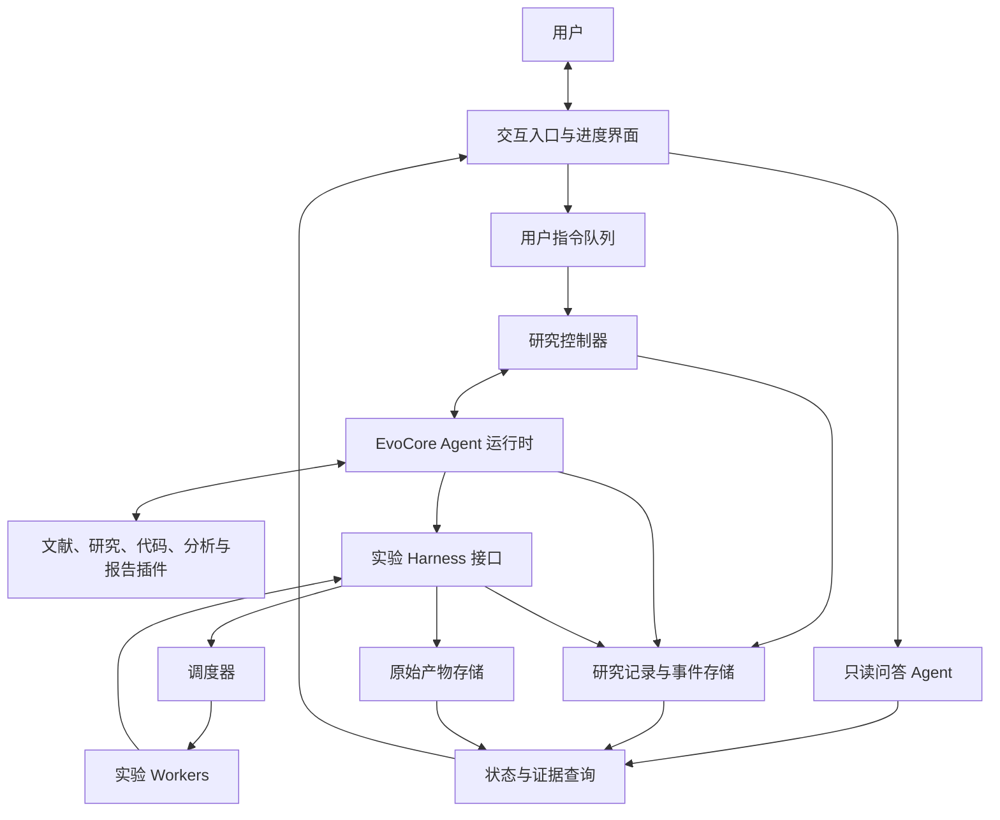
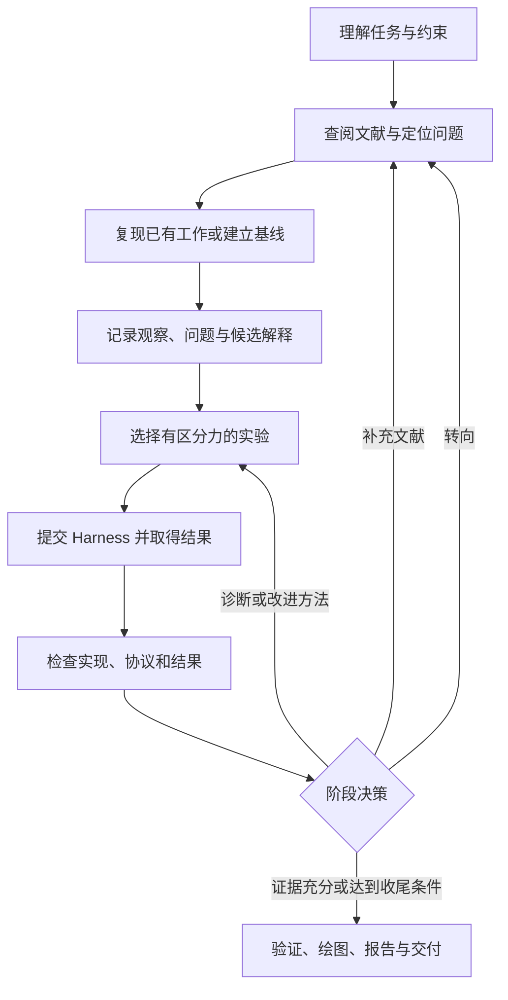

# EvoCore 自主科研系统：总体架构

状态：目标设计，部分独立骨架已落地。本文记录系统目标，不代表原运行入口已经具备这些能力；文件、类、接口与实现边界见 [实际代码模块](MODULES.md)。

配套文档：[实施路线](ROADMAP.md)。后续按阶段补充接口、数据结构和验证方案。

## 1. 系统目标

构建一个能够持续研究、保留证据、接受用户干预的自主科研系统。

Agent 接收任务后，可以查阅文献、复现已有工作、建立基线、记录观察、提出解释或方法、设计实验，并根据实际结果选择继续、转向、暂存或结束。文献核查贯穿研究过程。

最终交付是一份证据可追溯的研究报告及配套代码、原始结果、图表和复现说明，不强制产出完整论文。

研究贡献可以是新问题、旧问题的新方法、新评价指标、复现发现或有价值的负面结果。系统不以“必须发现新问题”或“必须提升指标”作为结束条件。

用户可以持续查看研究状态、询问进度、提出建议或修改约束。只读询问不阻塞主 Agent。

## 2. 架构原则

1. **内核保持小。** 内核负责模型与工具执行、生命周期、控制边界、状态提交和事件；科研策略通过插件或控制器实现。
2. **事实独立于聊天。** 实验结果、研究记录、用户指令不能仅保存在对话历史或压缩摘要中。
3. **执行与解释分开。** Harness 记录发生了什么；Agent 记录这些结果意味着什么，以及下一步做什么。
4. **所有执行路径一致。** 主 Agent、子 Agent 和恢复后的执行经过相同的工具入口、预算核算与执行前检查。
5. **科学路线允许调整。** 可以重访文献、改变问题或指标，但应创建新的计划或评价协议版本，保留变更依据。
6. **完整保留失败。** 程序错误、无效实验、假设被推翻和证据不足分别记录；修复生成新实验，不覆盖原始证据。
7. **界面读取正式记录。** 进度展示和用户问答基于同一状态快照、事件和证据，不另建一套手工更新的进度。

## 3. 组件全景

图中“写入存储”均通过统一提交接口完成。Agent 不直接修改状态数据库；实验 Worker 不直接改研究计划。

组件可以先部署为同一台机器上的模块和进程，不要求一开始建设分布式服务。

## 4. 组件职责与边界

| 组件 | 主要职责 | 边界 |
|---|---|---|
| Agent 运行时 | 模型调用、工具执行、子 Agent、统一钩子、调用预算、执行检查点 | 不写死具体科研领域和选题算法 |
| 研究控制器 | 维护当前问题与计划、接收结果和用户指令、安排下一步、控制收尾 | 不以固定答案或正向实验结果决定成功 |
| 科研插件 | 文献检索、复现规划、方法构思、代码、分析、阶段评审、报告 | 通过运行时使用工具，通过正式接口记录决定 |
| 实验 Harness | 接收冻结实验、维护任务生命周期、归档输出、核验产物、提供结果查询 | 不把执行成功等同于科学结论成立 |
| 调度器与 Workers | 资源分配、排队、隔离执行、心跳、超时与重试 | 不改变实验协议，不覆盖其他实验的代码或结果 |
| 研究记录与产物存储 | 保存版本化事实、证据关系、事件和可查询快照 | 不把摘要当作原始数据，不允许原地改写原始实验结果 |
| 只读问答 Agent | 根据快照回答进度、计划、成果和依据 | 不调用实验执行工具，不修改主研究状态 |
| 用户指令队列 | 持久保存建议与约束变更，记录接收及应用结果 | 不依赖终端 stdin 或直接编辑主 Agent 的历史消息 |
| 交互界面 | 展示状态、实验、分支、笔记、文献、产物和指令处理情况 | 不自行推断研究完成百分比或伪造实时状态 |

运行时扩展必须支持工具执行前的允许、拒绝或延后判断。不可绕过的执行约束属于运行时能力；具体科研质量规则可以配置。

## 5. 研究循环

这是可循环的工作过程，不是必须依次完成的固定流水线。用户已有基线时可以从分析开始；论文无法复现时记录原因，可以进行明确披露的近似复现或其他研究。

阶段决策应记录：当前证据、未决问题、备选路线、选择理由、下一步实验及停止条件。放弃方向也要保留其证据与理由。

### 持续文献核查

在确定问题、开始复现、观察到异常、开辟分支、多轮停滞和最终交付时检查相关文献。允许随时主动检索，并配置额外的检查频率。

文献记录包括实际获取的内容、可定位的依据、对当前研究的影响和未确认之处。缓存已有来源，避免频繁检索退化为重复调用。是否新颖或可行是待论证的判断，检索完成本身不是证明。

## 6. 统一研究记录

先统一以下概念，具体字段与存储实现后续细化。

| 对象 | 表达的内容 |
|---|---|
| 研究任务与计划版本 | 用户目标、约束、当前研究方向、预算、下一步 |
| 文献与复现记录 | 来源、已读内容、复现目标、原始设置、实际差异与结果 |
| 问题、假设与候选方法 | 要回答什么、可能解释、可证伪条件与相关工作 |
| 评价协议版本 | 数据、指标、比较条件、统计设计和适用范围 |
| 实验及执行尝试 | 冻结输入、父实验、任务状态、运行环境、输出与检查 |
| 观察与结论 | 观察到什么、支持与反对证据、不确定性、适用边界 |
| 阶段决策 | 继续、转向、暂存、结束，以及采用和放弃的理由 |
| 用户消息 | 询问、建议、明确指令，以及处理状态和生效的计划版本 |
| 产物与报告版本 | 代码、数据、图表、文献引用及报告对证据的引用 |

这些对象通过 ID 和版本关联，形成证据关系图。实验可有父子分支，也可关联多份证据；整体不强制限制为一棵树。

指标改变应形成新协议版本；需要比较的方法应在相同适用协议下重新评价。开发阶段的反复试验与最终独立验证分别披露。

## 7. 实验执行、并行与恢复

Agent 提交实验规格，Harness 返回任务 ID。Agent 可以等待结果、开展文献或其他工作；任务完成通过事件通知，结果通过查询取得。

每个正式实验绑定代码快照、数据与环境版本、参数、种子、资源需求、评价协议和研究目的。原始 stdout/stderr、测量数据与产物由 Harness 保存。

并行由配置和资源预算控制，先支持独立实验并行，再考虑多研究分支并行。不同实验使用独立目录或快照，不共享可变源码。研究状态通过统一入口提交，避免多个 Worker 直接覆盖同一 JSON 文件。

主 Agent 与实验任务生命周期分离：主 Agent 重启、上下文压缩或用户打开问答，不自动取消外部实验。恢复时先对账已有任务，再决定是否重试；任务 ID、提交幂等性和多次执行尝试需要有明确语义，不承诺所有外部副作用恰好发生一次。

## 8. 用户交互与可观测性

### 只读询问

问答 Agent 读取一致的研究快照，按需查阅实验、文献和笔记。回答注明状态时间及依据；简单状态查询可以直接返回结构化信息，不必每次调用模型。

主 Agent 不需要为了回答进度而暂停当前研究。

### 建议与方向修改

建议和明确指令分别记录。主 Agent 在每次决策、工具执行及新实验提交的适当边界接收消息，记录处理结果。方向修改产生新计划版本，旧实验仍保留并注明关联方向。

“已收到”和“已应用”分开显示。用户请求暂停或取消时，通过运行控制入口处理，并清楚显示对正在执行任务的影响。

### 用户可见的信息

- 当前问题、阶段、分支和明确记录的下一步意图。
- 正在排队、执行、等待、检查的实验，以及它们各自的目的。
- 新增笔记、文献、代码、图表和报告版本。
- 当前支持、反对与尚未解决的证据。
- 资源使用、预算、阻塞原因、最近更新时间。
- 用户建议或指令的处理状态。

技术执行轨迹与科研记录分别展示，但通过同一批 ID 关联。显示可供用户理解的计划、依据和简要说明，不依赖原始模型思考文本。

## 9. 上下文与持久化

上下文分为三部分：

1. **持续保留的任务信息**：目标、用户约束、当前计划版本、预算、未处理指令。
2. **当前工作的必要信息**：选中分支、相关文献、实验接口、近期结果、待验证问题。
3. **按需查询的历史**：完整实验、旧方向、原始产物、文献全文、决策历史和长期经验。

压缩用于控制模型输入长度；正式记录与原始证据不随压缩丢失。报告生成和问答从存储检索依据，不仅依赖模型当前记得的内容。

持久工作流负责执行恢复，研究存储负责事实与版本。实现时明确各自权威范围，避免两套独立编排同时决定同一任务的状态。

## 10. 完成与交付

分别记录运行状态、交付验收状态和科学结论。报告交付完成不意味着假设成立；预算耗尽不自动意味着研究成功。

至少支持表达：有效交付、结果不确定、资源不足、执行失败、用户暂停和用户取消。具体状态枚举后续定义。

系统在预算中为验证、图表和报告预留额度。达到边界后限制新增研究分支，允许必要检查和诚实收尾。研究员自主决定结束；本地检查问题只记录，不启动独立 LLM 评审或自动返工，交付状态保留为 not_reviewed。

交付材料覆盖：

- 引言、问题与相关工作。
- 方法及其假设、适用条件。
- 实验设置、基线、结果、不确定性及可视化。
- 负面结果、失败、局限与未决问题。
- 真实文献引用、代码、环境、原始结果和复现命令。

主要结论和图表引用具体证据版本；被判定无效的实验不能被当作有效证据使用。

## 11. 与现有项目衔接

| 现有来源 | 复用方向 | 需要调整的边界 |
|---|---|---|
| `evo-core/evo_core/engine.py`、`protocol.py` | 轻量运行时、工具和插件接口 | 统一主/子执行路径，补执行前检查、外部控制与完整核算 |
| `research-harness/.../journal.py`、`evidence.py` | 研究对象、版本、原始证据归档 | 抽出与具体 Agent 引擎解耦的存储接口 |
| `research-harness/.../sandbox.py`、执行记录 | 实验环境、冻结输入、执行与导出 | 形成可提交、查询、恢复的任务接口 |
| `research-harness/.../temporal_runtime.py` | 外部持久编排与恢复 | 接入任务/指令事件，不仅提供阶段步数查询 |
| harness 的阶段、记忆与搜索组件 | 可选研究策略 | 不把通用科研强制变成单指标代码优化 |
| 原版 EvoScientist 的流事件、目标与交互实现 | 借鉴事件协议和用户交互边界 | 按能力提取，不整体搬回所有依赖与中间件 |

成熟方案的参考边界：

- [Temporal 消息机制](https://docs.temporal.io/encyclopedia/workflow-message-passing)：查询、异步指令和可确认更新。
- [LangGraph 持久化](https://docs.langchain.com/oss/python/langgraph/persistence)与[流事件](https://docs.langchain.com/oss/python/langgraph/streaming)：检查点、长期存储、状态和事件的划分；不是要求同时引入第二个编排器。
- [AIDE](https://github.com/WecoAI/aideml)：实验版本和分支搜索，作为可选策略。
- [MLflow Tracking](https://mlflow.org/docs/latest/tracking/)：参数、指标和产物的查询展示；不能替代研究证据与决策记录。

先通过适配层接入，固定实际复用的版本并验证行为，不一次性合并所有框架。

## 12. 本轮范围

本轮只确定目标、职责、数据流和实施顺序。尚未决定详细接口字段、数据库表、前端框架、部署拓扑或具体搜索算法。

下一步先细化“统一执行边界和正式状态”，再打通单分支端到端研究循环，之后增加交互和并行。每个阶段以可观察的运行行为验收，详见 [实施路线](ROADMAP.md)。
